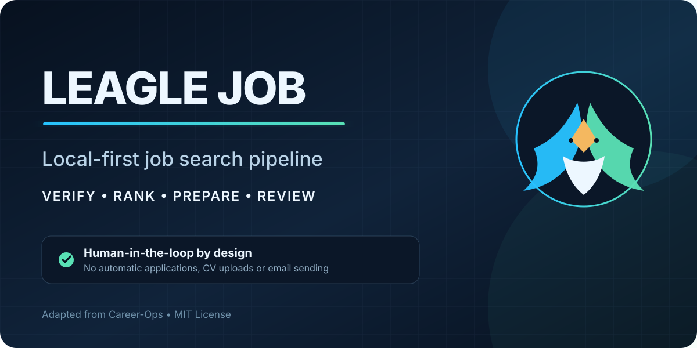
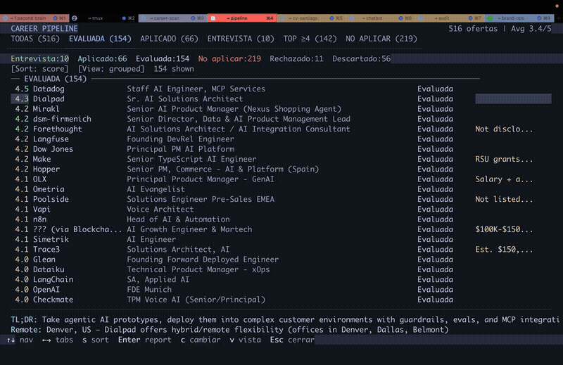

# Leagle Job

[English](README.md) | [Español](README.es.md)

<p align="center">
  <a href="https://github.com/netoaf/leagle-job"></a>
</p>

> **Procedencia:** Leagle Job es la adaptación local y Portugal-first de Afonso
> Neto de [Career-Ops](https://github.com/santifer/career-ops), creado por
> Santiago Fernández de Valderrama y distribuido bajo licencia MIT. Se
> conservan la atribución, la cita y la licencia originales.

<p align="center">
  <em>Un pipeline local y Portugal-first para prácticas y puestos junior.</em><br>
  <strong>Descubre, verifica, prioriza y prepara candidaturas con revisión humana en cada decisión.</strong><br>
  <em>Sin envíos, uploads de CV ni emails automáticos.</em>
</p>

<p align="center">
  
  
  
  
  
  
  
  <a href="https://discord.gg/8pRpHETxa4"></a>
  <br>
  
  
  
  
  
</p>

---

<p align="center">
  
</p>

<p align="center"><strong>Caso original de Career-Ops: 740+ ofertas evaluadas · 100+ CVs personalizados · 1 puesto conseguido</strong></p>

<p align="center"><a href="https://discord.gg/8pRpHETxa4"></a></p>

## Que es Leagle Job

Leagle Job adapta Career-Ops a una búsqueda local y Portugal-first. En vez de
trackear aplicaciones en un spreadsheet, proporciona un pipeline asistido por
IA que:

- **Evalua ofertas** con scoring estructurado A-F (10 dimensiones ponderadas)
- **Genera PDFs personalizados** -- CVs ATS-optimizados por oferta
- **Escanea portales** automaticamente (Greenhouse, Ashby, Lever, webs de empresas)
- **Procesa en batch** -- evalua 10+ ofertas en paralelo con sub-agentes
- **Trackea todo** en una fuente de verdad unica con checks de integridad

> **Importante: Esto NO es para spamear empresas.** Leagle Job es un filtro y
> sus puntuaciones son apoyo a la decisión. Verifica siempre la vacante y revisa
> cada CV, email y candidatura antes de enviar.

> **Aviso: las primeras evaluaciones no seran buenas.** El sistema no te conoce todavia. Dale contexto -- tu CV, tu historia profesional, tus proof points, tus preferencias, en que eres bueno, que quieres evitar. Cuanto mas lo nutras, mejor filtra. Piensa en ello como hacer onboarding a un recruiter nuevo: la primera semana necesita conocerte, luego se vuelve invaluable.

Construido por alguien que lo uso para evaluar 740+ ofertas, generar 100+ CVs personalizados, y conseguir un rol de Head of Applied AI. [Lee el case study completo](https://santifer.io/career-ops).

## Features

| Feature | Descripcion |
|---------|-------------|
| **Auto-Pipeline** | Pega una URL, obtiene evaluacion + PDF + entrada en tracker |
| **Evaluacion A-F** | Resumen del rol, match con CV, estrategia de nivel, research de comp, personalizacion, prep de entrevista (STAR+R) |
| **Banco de historias** | Acumula historias STAR+Reflexion entre evaluaciones -- 5-10 historias maestras que responden cualquier pregunta behavioral |
| **Scripts de negociacion** | Frameworks de negociacion salarial, pushback de descuentos geograficos, leverage de ofertas competidoras |
| **PDFs ATS** | CVs con keywords inyectados, diseño Space Grotesk + DM Sans |
| **Scanner de portales** | 45+ empresas pre-configuradas (Anthropic, OpenAI, ElevenLabs, Retool, n8n...) + queries en Ashby, Greenhouse, Lever, Wellfound |
| **Batch** | Evaluacion en paralelo con workers `claude -p` |
| **Dashboard TUI** | Terminal UI para navegar, filtrar y ordenar tu pipeline |
| **Human-in-the-Loop** | La IA evalua y recomienda, tu decides y actuas. El sistema nunca envia una aplicacion -- tu siempre tienes la ultima palabra |
| **Integridad de pipeline** | Merge automatico, dedup, normalizacion de estados, health checks |

## Inicio rapido

```bash
# 1. Clonar e instalar
git clone https://github.com/netoaf/leagle-job.git
cd leagle-job && npm install
npx playwright install chromium   # Necesario para generar PDFs

# 2. Verificar setup
npm run doctor                     # Valida todos los prerequisitos

# 3. Configurar
cp config/profile.example.yml config/profile.yml  # Editar con tus datos
cp config/scoring.example.yml config/scoring.yml  # Ajustar scoring local
cp config/jobfinder-rules.example.yml config/jobfinder-rules.yml  # Reglas locales
cp templates/portals.example.yml portals.yml       # Personalizar empresas

# 4. Añadir tu CV
# Crear cv.md en la raiz del proyecto con tu CV en markdown

# 5. Personalizar con Claude
claude   # Abrir Claude Code en este directorio

# Pidele a Claude que adapte el sistema a ti:
# "Cambia los arquetipos a roles de backend"
# "Traduce los modes a ingles"
# "Añade estas empresas a portals.yml"
# "Actualiza mi perfil con este CV que te pego"

# 6. Usar
# Pega una URL de oferta o ejecuta /career-ops
```

> **El sistema esta diseñado para que Claude lo personalice.** Modes, arquetipos, scoring, scripts de negociacion -- solo pidelo. Claude lee los mismos archivos que usa, asi que sabe exactamente que editar.

Guia completa en [docs/SETUP.md](docs/SETUP.md).

## Uso

Career-ops es un unico slash command con multiples modos:

```
/career-ops                → Mostrar todos los comandos
/career-ops {pega un JD}   → Pipeline completo (evaluar + PDF + tracker)
/career-ops scan           → Escanear portales
/career-ops pdf            → Generar CV ATS-optimizado
/career-ops batch          → Evaluar ofertas en batch
/career-ops tracker        → Ver estado de aplicaciones
/career-ops apply          → Rellenar formularios con IA
/career-ops pipeline       → Procesar URLs pendientes
/career-ops contacto       → Mensaje LinkedIn outreach
/career-ops deep           → Research profundo de empresa
```

O simplemente pega una URL o descripcion de oferta -- career-ops la detecta y ejecuta el pipeline completo.

## Como funciona

```
Pegas una URL o descripcion de oferta
        │
        ▼
┌──────────────────┐
│  Deteccion de    │  Clasifica: LLMOps / Agentic / PM / SA / FDE / Transformation
│  Arquetipo       │
└────────┬─────────┘
         │
┌────────▼─────────┐
│  Evaluacion A-F  │  Match, gaps, comp research, historias STAR
│  (lee cv.md)     │
└────────┬─────────┘
         │
    ┌────┼────┐
    ▼    ▼    ▼
 Report  PDF  Tracker
  .md   .pdf   .tsv
```

## Portales incluidos

El scanner viene con **45+ empresas** pre-configuradas y **19 queries** en los principales portales de empleo. Copia `templates/portals.example.yml` a `portals.yml` y añade las tuyas:

**AI Labs:** Anthropic, OpenAI, Mistral, Cohere, LangChain, Pinecone
**Voice AI:** ElevenLabs, PolyAI, Parloa, Hume AI, Deepgram, Vapi, Bland AI
**Plataformas AI:** Retool, Airtable, Vercel, Temporal, Glean, Arize AI
**Contact Center:** Ada, LivePerson, Sierra, Decagon, Talkdesk, Genesys
**Enterprise:** Salesforce, Twilio, Gong, Dialpad
**LLMOps:** Langfuse, Weights & Biases, Lindy, Cognigy, Speechmatics
**Automatizacion:** n8n, Zapier, Make.com
**Europa:** Factorial, Attio, Tinybird, Clarity AI, Travelperk

**Portales de empleo:** Ashby, Greenhouse, Lever, Wellfound, Workable, RemoteFront

## Dashboard TUI

El dashboard integrado en terminal te permite navegar tu pipeline visualmente:

```bash
cd dashboard
go build -o career-dashboard .
./career-dashboard --path ..
```

Features: 6 pestañas de filtro, 4 modos de ordenacion, vista agrupada/plana, previews lazy-loaded, cambios de estado inline.

## Estructura del proyecto

```
career-ops/
├── CLAUDE.md                    # Instrucciones del agente
├── cv.md                        # Tu CV (crealo tu)
├── article-digest.md            # Tus proof points (opcional)
├── config/
│   ├── profile.example.yml      # Template para tu perfil
│   ├── scoring.example.yml      # Defaults de scoring local
│   └── jobfinder-rules.example.yml # Defaults de seguridad local
├── modes/                       # 14 modos
│   ├── _shared.md               # Contexto compartido (personalizable)
│   ├── oferta.md                # Evaluacion individual
│   ├── pdf.md                   # Generacion de PDF
│   ├── scan.md                  # Scanner de portales
│   ├── batch.md                 # Procesamiento batch
│   └── ...
├── templates/
│   ├── cv-template.html         # Template de CV ATS-optimizado
│   ├── portals.example.yml      # Config del scanner
│   └── states.yml               # Estados canonicos
├── batch/
│   ├── batch-prompt.md          # Prompt autocontenido del worker
│   └── batch-runner.sh          # Script orquestador
├── dashboard/                   # Visor de pipeline en Go TUI
├── data/                        # Tus datos de tracking (gitignored)
├── reports/                     # Reports de evaluacion (gitignored)
├── output/                      # PDFs generados (gitignored)
├── fonts/                       # Space Grotesk + DM Sans
├── docs/                        # Setup, personalizacion, arquitectura
└── examples/                    # CV de ejemplo, report, proof points
```

## Tech Stack


- **Agente**: Claude Code con skills y modos personalizados
- **PDF**: Playwright/Puppeteer + template HTML
- **Scanner**: Playwright + Greenhouse API + WebSearch
- **Dashboard**: Go + Bubble Tea + Lipgloss (tema Catppuccin Mocha)
- **Datos**: Tablas Markdown + config YAML + ficheros TSV batch

## Mantenedor y proyecto original

Leagle Job es mantenido por [Afonso Neto](https://github.com/netoaf) como una
adaptación y extensión Portugal-first de
[Career-Ops](https://github.com/santifer/career-ops).

Career-Ops fue creado por
[Santiago Fernández de Valderrama](https://santifer.io). Se conservan su
licencia MIT, cita y autoría originales. Los resultados del caso de estudio
original se identifican siempre como resultados del proyecto upstream.

## Documentacion

- [SETUP.md](docs/SETUP.md) -- Guia de instalacion
- [CUSTOMIZATION.md](docs/CUSTOMIZATION.md) -- Como personalizar
- [ARCHITECTURE.md](docs/ARCHITECTURE.md) -- Como funciona el sistema

## Aviso legal

**Leagle Job es una herramienta local y open source — NO un servicio alojado.** Al usar este software, aceptas que:

1. **Tu controlas tus datos.** Tu CV, datos de contacto e informacion personal se quedan en tu maquina y se envian directamente al proveedor de IA que elijas (Anthropic, OpenAI, etc.). No recopilamos, almacenamos ni tenemos acceso a tus datos.
2. **Tu controlas la IA.** Los prompts por defecto instruyen a la IA a no enviar aplicaciones automaticamente, pero los modelos pueden comportarse de forma impredecible. Si modificas los prompts o usas otros modelos, lo haces bajo tu responsabilidad. **Revisa siempre el contenido generado antes de enviarlo.**
3. **Tu cumples con los terminos de terceros.** Debes usar esta herramienta de acuerdo con los Terminos de Servicio de los portales de empleo (Greenhouse, Lever, Workday, LinkedIn, etc.). No uses esta herramienta para spamear empresas.
4. **Sin garantias.** Las evaluaciones son recomendaciones, no verdad absoluta. Los modelos pueden inventar habilidades o experiencia. Los autores no son responsables de resultados laborales, candidaturas rechazadas, restricciones de cuenta ni ninguna otra consecuencia.

Ver [LEGAL_DISCLAIMER.md](LEGAL_DISCLAIMER.md) para mas detalles. Este software se proporciona bajo la [Licencia MIT](LICENSE) "tal cual", sin garantia de ningun tipo.

## Licencia

MIT

## Conecta

[](https://github.com/netoaf)
[](https://www.linkedin.com/in/afonso-neto-a06581374/)

Para el proyecto y la comunidad originales, visita
[Career-Ops](https://github.com/santifer/career-ops).
