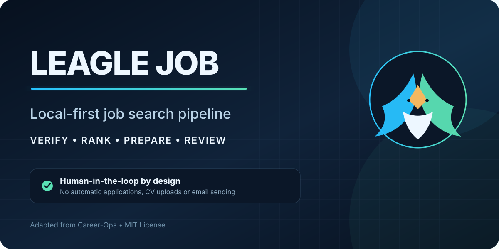

<p align="center">
  
</p>

<p align="center">
  <strong>A local job-search pipeline for internships and junior roles in Portugal.</strong><br>
  It finds, verifies and ranks vacancies. You make every decision.
</p>

<p align="center">
  <a href="https://github.com/netoaf/leagle-job/actions/workflows/ci.yml"></a>
  
  
  
  
</p>

<p align="center">
  <a href="README.md">English</a> · <a href="README.es.md">Español</a>
</p>

> Built on [Career-Ops](https://github.com/santifer/career-ops) by Santiago Fernández
> de Valderrama (MIT). The original license, citation and authorship are preserved.

## Why it exists

Job boards in Portugal are scattered across company portals, ATS platforms and
local boards. Generic AI job tools optimise for volume and act on your behalf.
Leagle Job does the opposite: it gathers evidence, scores fit honestly and stops
before anything leaves your machine.

**It never submits applications, uploads CVs or sends emails.**

## What I added to Career-Ops

| Area | Contribution |
| --- | --- |
| **Portugal-first scanning** | Scan profiles with regional quotas, plus adapters for local boards and Eightfold career sites |
| **Evidence-based scoring** | Fit is scored only against confirmed candidate evidence, never invented skills |
| **CV selection** | Picks the strongest existing CV variant per vacancy and shows the diff for review |
| **Safe fetching** | Every HTTP call and Playwright fallback goes through a network guard that blocks private and unsafe targets |
| **Source health** | Audits every portal for dead URLs, blocks and missing adapters before a scan runs |
| **Privacy gates** | Candidate data, reports and runtime output stay local and are excluded from Git by contract |
| **Release discipline** | Least-privilege CI with pinned actions and full-history secret scanning |

**56 unit tests** cover network safety, adapters, normalisation, deduplication,
scoring and CV selection. Writing them exposed and fixed two real defects.

## How it works

```text
 sources ──► safe fetch ──► normalise + dedupe ──► score against evidence
                                                         │
          you review ◄── report + CV variant + tracker ◄─┘
```

The last live audit checked **184 sources**: 158 healthy, the rest flagged for
repair before they could pollute a scan.

## Run it

```bash
git clone https://github.com/netoaf/leagle-job.git
cd leagle-job && npm ci
npx playwright install chromium
npm run doctor
```

Copy the example configs in `config/` and `templates/portals.example.yml`, add
your CV as `cv.md`, then:

```bash
npm run jobfinder:pt:dry-run -- --limit 30   # preview, writes nothing
npm run jobfinder:pt -- --limit 30           # rank and record new matches
npm run portals:audit                        # check source health
npm test                                     # full health check
```

On Windows, `setup.bat` installs everything; see [COMECE-AQUI.md](COMECE-AQUI.md).

AI-assisted modes (single evaluation, batch, PDF, tracker) run from Claude Code,
OpenCode or Codex with `/career-ops`. See [docs/SETUP.md](docs/SETUP.md) and
[docs/ARCHITECTURE.md](docs/ARCHITECTURE.md).

## Stack

Node.js scanners and pipeline · Playwright for rendering and PDF · Go + Bubble Tea
terminal dashboard · Markdown, YAML and TSV as the data layer.

## Responsible use

Scores are decision support, not facts. Review every CV and message before you
send it, and respect each portal's terms of service. Full terms in
[LEGAL_DISCLAIMER.md](LEGAL_DISCLAIMER.md).

## License

MIT. Third-party notices in [THIRD_PARTY_NOTICES.md](THIRD_PARTY_NOTICES.md).
